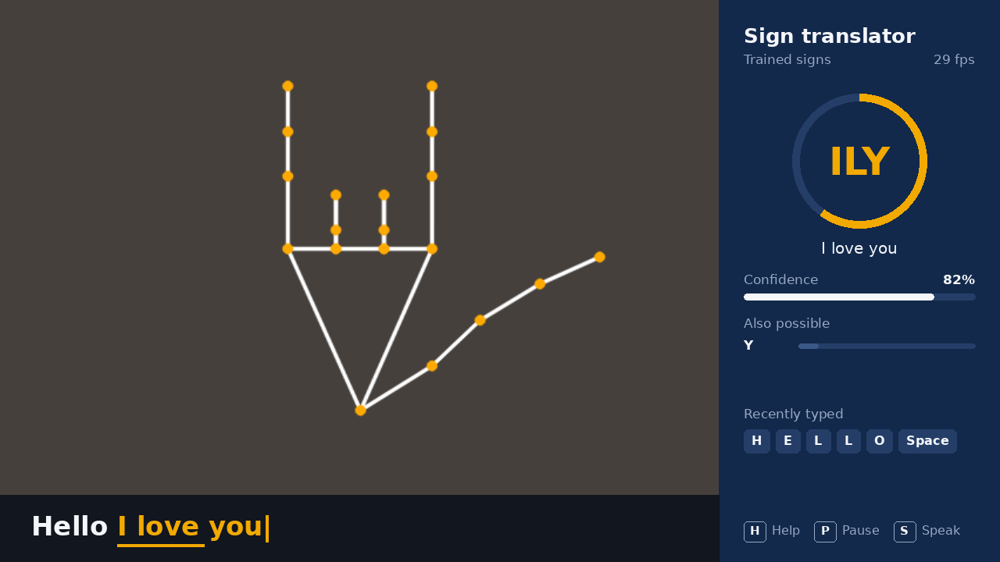
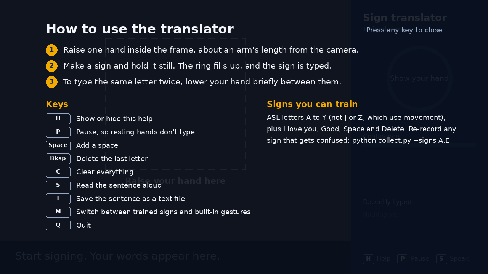
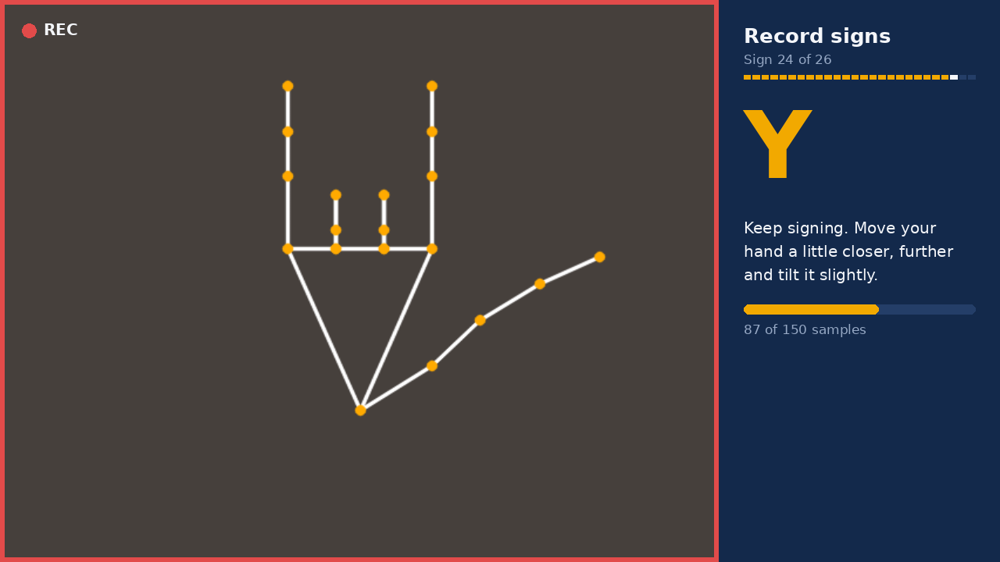

<!-- profile-card:start -->
<p align="center">
  <a href="https://github.com/YashasRajR"></a>
</p>
<!-- profile-card:end -->

# Real-Time Sign Language Translator

Turns American Sign Language (ASL) fingerspelling into text, live from your webcam. Sign letters one at a time and they build into words and sentences as captions on screen. The sentence can be read aloud and saved.

It uses **MediaPipe** to track 21 points on your hand, **OpenCV** for the camera, and a **scikit-learn** classifier trained on samples you record yourself. Everything runs offline on your own computer.



*Interface preview: the camera feed on the left (shown here with a drawn hand skeleton), live captions along the bottom, and on the right the sign being held, how confident the model is, close alternatives and recently typed signs.*

## Features

- **Live fingerspelling:** recognises 24 ASL letters plus "I love you", "Good", and Space and Delete signs.
- **Live captions:** the sign you're holding appears in amber and fills in. Hold it for about half a second and it's typed.
- **No accidental repeats:** holding a letter types it once. To type a double letter, drop your hand briefly or change sign.
- **Clear feedback:** the ring flashes when a sign is typed, a strip shows recently typed signs, and "Also possible" lists the next-best guesses when two letters look alike.
- **Hand guidance:** a guide frame shows where to raise your hand, and live tips say when to move closer, move back or keep your whole hand in view. Badly placed hands don't type anything.
- **Pause and help:** press P to rest your hands without typing. Press H for a help screen, which also opens automatically until you've trained your own signs.
- **Works with either hand:** left-hand signs are mirrored before recognition.
- **Built-in gestures:** numbers 0–5, thumbs up, thumbs down and "I love you" work without any training.
- **Guided recording:** a recording mode walks you through each sign with a short description, a REC indicator, a sample counter and progress through the whole set.
- **Read aloud and save:** speaks the sentence offline and saves transcripts as text files.
- **Training report:** shows accuracy on held-out samples and a confusion matrix of which signs get mixed up.

## How it works

```
Webcam ──▶ MediaPipe Hand Landmarker ──▶ 21 hand points ──▶ normalise ──▶ classifier ──▶ stabiliser ──▶ captions
           (OpenCV, mirrored)            (x, y, z)          (position,     (Random       (hold to type,
                                                             size, hand)    Forest)       no repeats)
```

1. **Hand tracking.** MediaPipe's Hand Landmarker finds 21 points on the hand in each frame.
2. **Normalising.** Points are centred on the wrist and scaled to a fixed size, so it doesn't matter where your hand is or how far it is from the camera. Left hands are mirrored. Rotation is kept on purpose, because some letters (G and Q, K and P) differ only in which way they point.
3. **Features.** 63 coordinates plus 10 distances between fingertips.
4. **Classifier.** A Random Forest (scikit-learn) trained on your recorded samples, plus augmented copies (slightly rotated, scaled and jittered) so it generalises better.
5. **Stabiliser.** A sign must be held for about 12 frames above 55% confidence before it's typed, which filters out flicker between letters.

## Setup

You need **Python 3.10–3.12** and a webcam.

```bash
python -m venv venv
venv\Scripts\activate        # Windows  (macOS/Linux: source venv/bin/activate)
pip install -r requirements.txt
```

The first time the app starts, it downloads MediaPipe's hand model (about 8 MB) into `models/`.

## Usage

**1. Try the built-in gestures right away**

```bash
python translate.py --builtin
```

**2. Record your signs** (about 1–2 minutes per sign)

```bash
python collect.py                  # A–Y alphabet plus Space and Delete
python collect.py --set words      # I love you, Good, Space, Delete
python collect.py --signs A,E,S    # re-record specific signs
```

For each sign, press **Space** when you're ready, then hold the sign and move your hand a little (closer, further, slight tilts) while it records. More variety means better recognition.

**3. Train**

```bash
python train.py
```

This prints the accuracy on held-out samples and saves `models/confusion_matrix.png`.

**4. Translate**

```bash
python translate.py
```

On Windows, you can also double-click `start.bat`.

| Key | Action |
|---|---|
| H | Show or hide help |
| P | Pause, so resting hands don't type |
| Space | Add a space |
| Backspace | Delete the last letter |
| C | Clear the sentence |
| S | Read the sentence aloud |
| T | Save the sentence to `transcripts/` |
| M | Switch between trained signs and built-in gestures |
| Q or Esc | Quit |

| Help screen | Recording a sign |
|---|---|
|  |  |

## Tests

```bash
pytest -q
```

The tests use synthetic hand shapes, so no webcam is needed. They cover feature normalisation, built-in gestures, hand-position guidance, the stabiliser, sentence building, training and the window rendering.

## Project structure

```
signlang/
  tracker.py     MediaPipe hand tracking and skeleton drawing
  features.py    landmark normalisation, features and augmentation
  gestures.py    built-in rule-based gestures
  classifier.py  dataset CSV, training, saving and prediction
  stabilizer.py  turns noisy per-frame predictions into typed signs
  sentence.py    builds text from signs
  ui.py          window layout and captions
  speech.py      offline text-to-speech
collect.py       record samples
train.py         train and evaluate
translate.py     live translator
```

## Limitations

- **Letters only, plus a few words.** J and Z are drawn in the air in ASL, and most word signs (such as hello and thank you) involve movement or touching the face. This version recognises a single hand pose, so it doesn't support them. Recognising movement with a sequence model (for example an LSTM over landmark sequences) is the natural next step.
- **Trained on your own hands.** Accuracy depends on the samples you record. A model trained by one person may work less well for someone else until they add their own samples.
- **One hand at a time.** Two-handed sign languages such as Indian Sign Language would need two-hand features.

## Author

**Yashas Raj R**: [GitHub](https://github.com/YashasRajR)
